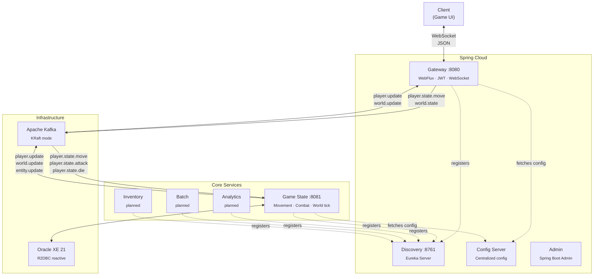
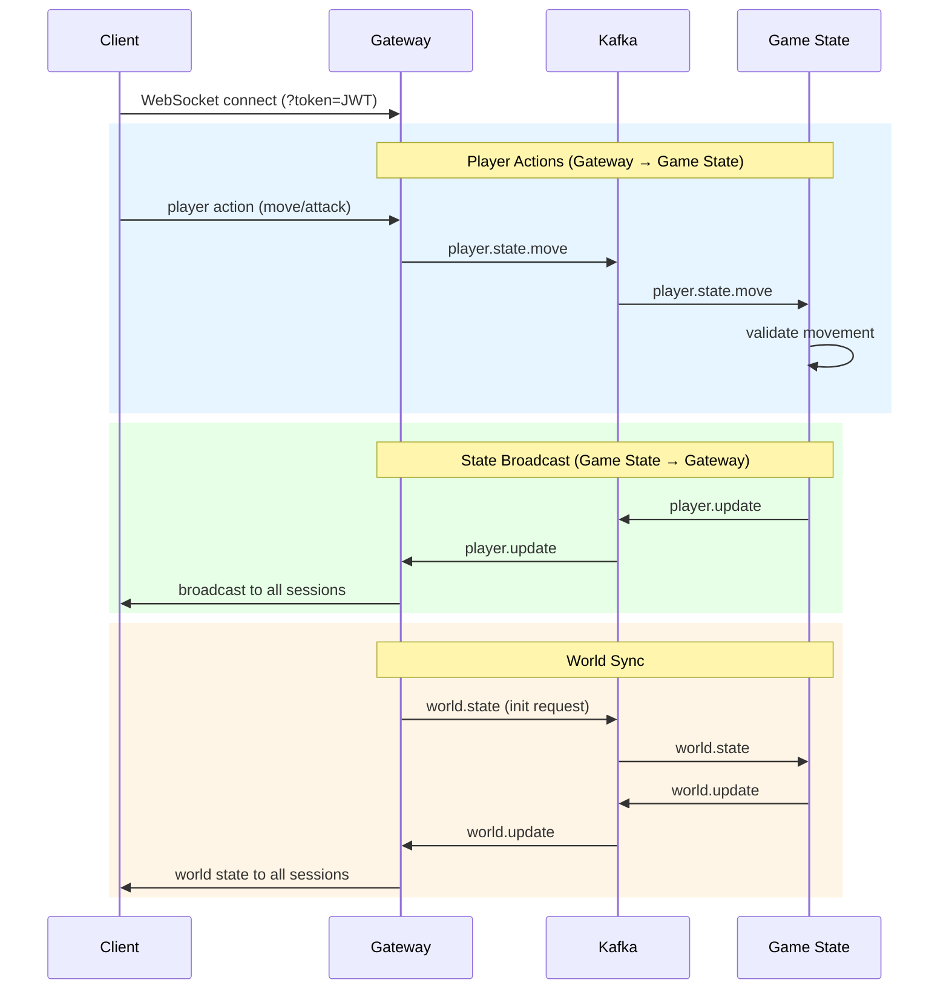

# RPG Service — MMO Backend

Distributed backend for a real-time MMO RPG built with **Java 21**, **Spring Boot 3.5.6**, and **Spring Cloud 2025.0.0**.

Players connect via WebSocket, and the system processes movement, combat, inventory and world state through **Kafka-driven event flows** across independent microservices.

## Architecture



### Hexagonal Architecture

The core services (`game-state`, `gateway`) follow a **ports & adapters** layout:

```
service/
├── application/          # Use cases, services, DTOs
│   ├── bridge/           # Reactive bridges (Sinks) between Kafka and WebSocket
│   ├── config/           # Kafka consumers, security
│   └── dto/              # Data transfer objects
├── domain/
│   └── model/            # Pure domain: MoveInputData, MoveResult, ValidatedPosition
└── infrastructure/
    ├── messager/          # Kafka producers & consumers (adapters)
    ├── persistence/
    │   ├── entity/        # JPA/R2DBC entities
    │   └── repository/    # Repository interfaces
    ├── api/               # REST controllers
    └── ws/                # WebSocket handlers
```

Domain models have no framework dependencies. Infrastructure adapters (Kafka, DB, WebSocket) are pluggable.

## Services

| Service | Role | Stack |
|---|---|---|
| **gateway** | Entry point — WebSocket handling, JWT auth, route proxy | Spring Cloud Gateway, WebFlux, Spring Security, jjwt |
| **game-state** | Core game logic — movement validation, entity handling, world tick | Spring Boot, R2DBC, Caffeine cache |
| **discovery** | Service registry | Eureka Server |
| **config** | Centralized configuration | Spring Cloud Config Server |
| **admin** | Service health monitoring | Spring Boot Admin Server |
| **analytics** | Metrics and KPIs from game events | Skeleton — WebFlux, Kafka deps ready |
| **batch** | Periodic data processing | Skeleton — Spring Batch, JPA, Oracle |
| **inventory** | Player inventory management | Skeleton — R2DBC ready |

## Event Flow (Kafka)

The system uses **event-driven architecture** with Apache Kafka as the message backbone.

### Topics and flow direction



### Combat and lifecycle topics

| Topic | Producer | Consumer | Purpose |
|---|---|---|---|
| `player.state.move` | Gateway | Game State | Player movement input |
| `player.state.attack` | Gateway | Game State | Attack actions |
| `player.state.takedmg` | Gateway | Game State | Damage received |
| `player.state.health` | Gateway | Game State | Health updates |
| `player.state.die` | Gateway | Game State | Death events |
| `player.state.respawn` | Gateway | Game State | Respawn requests |
| `player.update` | Game State | Gateway | Validated entity state broadcast |
| `world.update` | Game State | Gateway | World state synchronization |
| `world.state` | Gateway | Game State | World initialization |
| `player.item` | Game State | Game State | Inventory item events |
| `entity.update` | Game State | — | Entity state changes |

## Reactive Bridge Pattern

Gateway and Game State communicate through a **reactive bridge** using Project Reactor `Sinks`:

```java
// PlayerStateBridge.java (game-state)
@Service
public class PlayerStateBridge {
    private final Sinks.Many<EntityStateDTO> sink =
        Sinks.many().multicast().onBackpressureBuffer();

    public void emit(EntityStateDTO dto) {
        sink.tryEmitNext(dto);
    }

    public Flux<EntityStateDTO> getFlux() {
        return sink.asFlux();
    }
}
```

Kafka consumers push events into the sink; WebSocket handlers subscribe to the flux and stream updates to connected clients. This decouples message ingestion from delivery with **backpressure support**.

## Real-Time Communication

The Gateway handles WebSocket connections with per-session tracking:

- Sessions stored in `ConcurrentHashMap<entityId, SessionInfo>`
- JWT authentication via query parameter on connection
- Incoming player actions are forwarded to Kafka topics
- Outgoing game state is streamed from reactive bridges

## Game State Domain

The `game-state` service handles:

- **Movement validation** — max speed, tolerance, tick rate checks
- **Entity handling** — players, NPCs, mobs with spawn points
- **World initialization** — `@Scheduled` tick every 60s for world state
- **Item interaction** — pickup range, inventory events
- **Physics engine** — service stub ready for implementation
- **Zone management** — zone-based entity partitioning

### Domain model

```
PlayerEntity, NPCEntity, ActiveMobEntity, ZoneEntity
WorldItemEntity, ItemTemplateEntity, PlayerInventoryEntity
MobSpawnPointEntity
```

## Tech Stack

| Layer | Technology |
|---|---|
| Language | Java 21 |
| Framework | Spring Boot 3.5.6 |
| Cloud | Spring Cloud 2025.0.0 (Eureka, Config, Gateway) |
| Messaging | Apache Kafka (KRaft mode) |
| Database | Oracle XE 21 via R2DBC (reactive) |
| Real-time | WebSocket (Spring WebFlux) |
| Security | JWT (jjwt), Spring Security, BCrypt |
| Caching | Caffeine |
| Observability | Spring Boot Admin, Micrometer Tracing, Zipkin |
| Build | Maven (infra services) + Gradle (game services) |
| Containers | Docker Compose (Kafka, Oracle) |
| Helpers | Python scripts for data seeding and Kafka simulation |

## Getting Started

### Prerequisites

- Java 21
- Docker & Docker Compose
- Maven and Gradle

### Run infrastructure

```bash
# Start Kafka (KRaft mode)
cd kafka && docker-compose up -d

# Start Oracle XE
cd oracledb && docker-compose up -d
```

### Start services (in order)

```bash
# 1. Discovery (Eureka)
cd discovery && ./mvnw spring-boot:run

# 2. Config Server
cd config && ./mvnw spring-boot:run

# 3. Game State
cd game-state && ./gradlew bootRun

# 4. Gateway
cd gateway && ./gradlew bootRun
```

### Seed world data

```bash
python insert_world_items.py
```

### Simulate player traffic

```bash
python kafka-entity-state.py
```

## Status

This is an active personal project. Core services (Gateway, Game State) are functional. Analytics, Batch, and Inventory are scaffolded with dependencies ready for implementation.

## License

MIT
